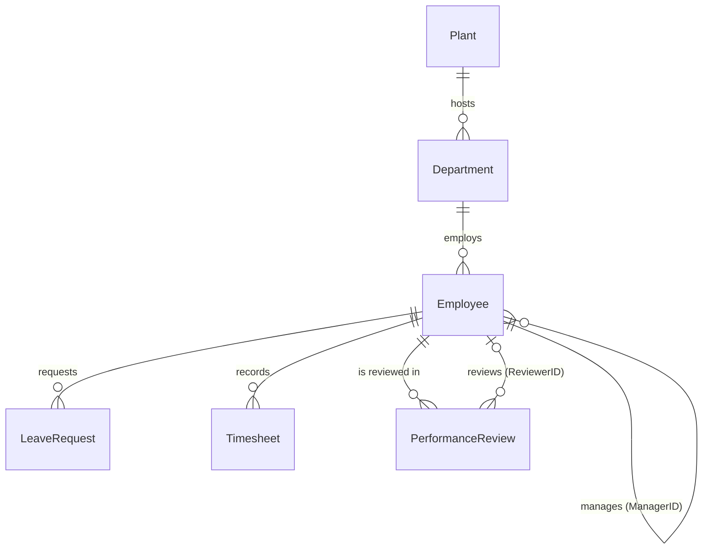

# WorkHub – Employee and HR Management System

**Sprint 1 – Database layer** · Hexaware capstone case study · Python track

WorkHub replaces the paper forms and shared Excel files that **Ferrovia Industrial Group**
(a manufacturer with 1,200 employees across four plants) uses for HR. It covers leave management,
payroll inputs from timesheets, performance-review cycles and the reporting hierarchy.

This repository contains **Sprint 1: the database layer**:
- **SQL Server:** schema, constraints, sample data, reports (views and functions), stored procedures, triggers and a cursor job.
- **MongoDB:** collections, validation and aggregation pipelines.

The Python application layers are built in Sprints 2–4 (see [Roadmap](#roadmap)).

| | |
|---|---|
| Relational database | Microsoft SQL Server (Express or higher), managed with SSMS |
| Document database | MongoDB 7+ with `mongosh` |
| Database name | `WorkHubDB` (both databases) |

---

## Contents
1. [Repository structure](#repository-structure)
2. [Quick start](#quick-start)
3. [Database design](#database-design)
4. [SQL Server objects](#sql-server-objects)
5. [MongoDB](#mongodb)
6. [Verification](#verification)
7. [Sprint 1 acceptance criteria](#sprint-1-acceptance-criteria)
8. [Sprint 1 summary: velocity and retrospective](#sprint-1-summary-velocity-and-retrospective)
9. [Roadmap](#roadmap)

---

## Repository structure

```
WORKHUB/
├── README.md
├── setup_databases.ps1            # rebuilds SQL Server + MongoDB in the correct order
├── docs/
│   └── ER_Diagram.md              # ER diagram (Mermaid) and relationships
├── sql/
│   ├── 01_create_schema.sql       # WorkHubDB, 6 tables, 25 named constraints, indexes
│   ├── 02_sample_data.sql         # 1,824 rows (Timesheet: 1,710)
│   ├── 03_verify_constraints.sql  # valid + invalid row per constraint -> 25 PASS
│   ├── 04_reporting_queries.sql   # hierarchy (recursive CTE), headcount, payroll inputs
│   ├── 05_functions_and_views.sql # 4 functions, 10 report views
│   ├── 06_stored_procedures.sql   # workflows + 6 report procedures
│   ├── 07_triggers.sql            # audit tables + 6 triggers
│   ├── 08_cursor_job.sql          # monthly payroll-input cursor job + job log
│   ├── 09_course_waitlist.sql     # new requirement: training course waitlist
│   └── 10_stage1_demo.sql         # safe demo of every object (changes rolled back)
├── mongodb/
│   ├── 01_collections_and_validation.js
│   ├── 02_seed_data.js
│   ├── 03_aggregation_pipelines.js
│   └── 04_validation_tests.js
├── jobs/
│   └── run_monthly_payroll_job.bat  # scheduled with Windows Task Scheduler
└── entity/ dao/ exception/ util/ main/ tests/   # application layers – implemented from Sprint 2
```

---

## Quick start

### Prerequisites
- SQL Server (Express is fine) and **SSMS**. Default instance name used here: `localhost\SQLEXPRESS`.
- `sqlcmd` (installed with SQL Server / SSMS tools).
- MongoDB server running on `mongodb://localhost:27017` and **mongosh**.

### Option A – one command (PowerShell, from the repository folder)
```powershell
powershell -ExecutionPolicy Bypass -File .\setup_databases.ps1
# SQL Server only:
powershell -ExecutionPolicy Bypass -File .\setup_databases.ps1 -SkipMongo
# Different SQL Server instance:
powershell -ExecutionPolicy Bypass -File .\setup_databases.ps1 -SqlServer "localhost"
```
The script drops and recreates `WorkHubDB`, runs every script in order, generates October 2026
payroll inputs, loads MongoDB and prints the row counts.

### Option B – SSMS
Connect to `localhost\SQLEXPRESS` with Windows Authentication. Then open each file in `sql/`
(**File → Open → File**) and press **F5**, in this order:

`01` → `02` → `05` → `06` → `07` → `08` → `09`. After that, `03`, `04` and `10` can be run at any time.

> ⚠️ `01_create_schema.sql` **drops** WorkHubDB. Always run `02_sample_data.sql` straight after it,
> otherwise every table is empty.

Then load MongoDB:
```powershell
mongosh "mongodb://localhost:27017" --file mongodb/01_collections_and_validation.js
mongosh "mongodb://localhost:27017" --file mongodb/02_seed_data.js
```

---

## Database design

### Tables (case study §3)

| Table | Key columns and constraints | Rows |
|---|---|---|
| **Plant** | `PlantID` PK identity · `PlantName` UNIQUE · `City` | 10 |
| **Department** | `DepartmentID` PK · `DepartmentName` · `PlantID` FK → Plant | 12 |
| **Employee** | `EmployeeID` PK · `Email` UNIQUE · `DepartmentID` FK · `ManagerID` FK → Employee · `Salary` CHECK ≥ 0 · CHECK not own manager | 30 |
| **LeaveRequest** | `LeaveID` PK · `EmployeeID` FK · `LeaveType` CHECK · `EndDate ≥ StartDate` · `Status` DEFAULT 'Pending' | 30 |
| **Timesheet** | `TimesheetID` PK · `EmployeeID` FK · `HoursWorked` CHECK 0–24 · `OvertimeHours` DEFAULT 0 | **1,710** |
| **PerformanceReview** | `ReviewID` PK · `EmployeeID` FK · `ReviewerID` FK · `Rating` CHECK 1–5 | 32 |

Data types follow the SQL Server mapping in §3.3: `INT IDENTITY(1,1)`, `NVARCHAR(n)`,
`DECIMAL(p,s)` and `DATE`.

**25 named constraints:** 6 PK, 7 FK, 2 UNIQUE, 8 CHECK and 2 DEFAULT. Plus 6 indexes on the foreign-key columns.

### Relationships

- The three relationships required by the case study (LeaveRequest, Timesheet and PerformanceReview, each **many-to-one** with Employee) use `ON DELETE CASCADE`.
- The other foreign keys were added to keep the data consistent.
- The full diagram with every column is in [docs/ER_Diagram.md](docs/ER_Diagram.md).

### Sample data
- Hierarchy: Arjun Mehta (Director) → 8 heads → staff.
- Leave in all statuses: 19 Approved, 9 Pending, 2 Rejected. Three people are on leave on 19 Nov 2026.
- A recursive CTE generates one timesheet row per employee per weekday, 1 Sep – 18 Nov 2026 (30 × 57 = 1,710).
- Reviews cover the 2025 cycle and part of the 2026 cycle.

---

## SQL Server objects

| Type | Objects |
|---|---|
| **Functions** | `fn_WorkingDays`, `fn_IsManager`, `fn_LeaveEntitlement`, `fn_LeaveBalance(@Year)` (inline table-valued) |
| **Views (reports)** | `vw_EmployeeDirectory`, `vw_ReportingHierarchy`, `vw_DepartmentHeadcount`, `vw_EmployeesOnLeaveToday`, `vw_PendingLeaveApprovals`, `vw_SalaryDistributionByDepartment`, `vw_ReviewCycleCompletion`, `vw_LeaveBalanceCurrentYear`, `vw_MonthlyTimesheetSummary`, `vw_AverageOvertimeByDepartment`, `vw_CourseWaitlist` |
| **Stored procedures** | `usp_RequestLeave`, `usp_ApproveLeave`, `usp_RejectLeave`, `usp_GetLeaveBalance`, `usp_SubmitTimesheet`, `usp_SubmitPerformanceReview`, `usp_AssignManager`, `usp_GetEmployeeById`, `usp_Report_DepartmentsByHeadcount`, `usp_Report_EmployeesOnLeave`, `usp_Report_AverageOvertimeByDepartment`, `usp_Report_TopRatedEmployees`, `usp_Report_PendingLeaveApprovals`, `usp_Report_SalaryDistribution`, `usp_EnrollInCourse`, `usp_CancelEnrollment` |
| **Triggers** | `trg_LeaveRequest_Audit`, `trg_LeaveRequest_NoOverlap`, `trg_Timesheet_DailyLimit`, `trg_PerformanceReview_OnePerCycle`, `trg_Employee_NoCircularManager`, `trg_Employee_SalaryHistory`, `trg_CourseEnrollment_Capacity`, `trg_CourseEnrollment_PromoteWaitlist` |
| **Cursor job** | `usp_Job_GenerateMonthlyPayrollInputs` → `PayrollInput`, logged in `JobRunLog` |
| **Supporting tables** | `LeaveRequestAudit`, `SalaryHistory`, `PayrollInput`, `JobRunLog`, `TrainingCourse`, `CourseEnrollment` |

### Business error numbers
Procedures and triggers raise errors with `THROW` and fixed numbers, so any client can tell the errors apart:

| Number | Meaning |
|---|---|
| 50001 | Invalid leave request (dates, overlap, not pending) |
| 50002 | Insufficient leave balance |
| 50003 | Invalid timesheet (hours outside 0–24, daily total > 24) |
| 50004 | Unauthorized approval (not the requester's manager) |
| 50005 | Duplicate review in the same cycle |
| 50006 | Employee not found |
| 50007 | Circular reporting |
| 50008 | Course enrolment (course full, not found, already enrolled) |
| 50000 | General validation (e.g. rating outside 1–5) |

### Triggers – why
A CHECK constraint sees only one row. Triggers enforce the rules that compare several rows:
overlapping approved leave, the 24-hour daily total, one review per year and reporting cycles.
They also keep an audit trail (`LeaveRequestAudit`, `SalaryHistory`). Because they run even for
direct SQL, these rules cannot be bypassed.

### Cursor job – monthly payroll inputs
`usp_Job_GenerateMonthlyPayrollInputs @Year, @Month` (defaults to the previous month) works like this:
1. Logs the run in `JobRunLog`.
2. Deletes that month's existing rows, so the job can be run again safely.
3. Uses a `LOCAL FAST_FORWARD` cursor to go through the employees one at a time.
4. For each employee, adds up the month's timesheets and writes one `PayrollInput` row:
   - Base pay = salary ÷ 12.
   - Overtime pay = hourly rate × overtime hours × 1.5. Managers are overtime-exempt (× 0).
   - Deductions = 12% provident fund on base pay + 10% tax on gross pay.
   - Net pay = gross pay − deductions.

October 2026 result: 30 employees, gross **2,736,801.03**, deductions 574,980.10, net **2,161,820.93**.

SQL Server Express has no SQL Server Agent, so `jobs/run_monthly_payroll_job.bat` runs the job
through `sqlcmd`. Schedule it monthly in **Windows Task Scheduler**.

### New requirement – training course waitlist (`09_course_waitlist.sql`)
> *As an employee I want to enrol in a training course and, if it is full, join a waitlist, so that
> I am enrolled automatically, in the order I joined, as soon as a seat frees up.*

- `usp_EnrollInCourse` enrols you if a seat is free, otherwise puts you on the waitlist. It locks the course row with `UPDLOCK, HOLDLOCK`, so two people can't take the last seat at the same time.
- `usp_CancelEnrollment` cancels a place. A trigger then promotes the earliest waitlisted employee.
- A capacity trigger ensures `Enrolled` never exceeds the course capacity.
- Waitlist positions are calculated with `ROW_NUMBER()` in `vw_CourseWaitlist`, so a cancellation never requires renumbering.
- The application side of the waitlist (entities, service and menu) is in the backlog for Sprints 2–3.

---

## MongoDB

The MongoDB database `WorkHubDB` holds document-shaped HR data. `employeeId` in every document is the
`EmployeeID` from SQL Server.

| Collection | Docs | Content |
|---|---|---|
| `employee_profiles` | 30 | skills `[ {name, level 1–5} ]`, certifications, languages, emergency contact |
| `review_feedback` | 93 | 360° feedback: giver and relationship, rating 1–5, strengths, improvements |
| `hr_notifications` | 22 | review reminders, leave decisions, payroll ready, waitlist promotions |

### Validation
- Every collection has a `$jsonSchema` validator with `validationAction: "error"`. It checks required fields, BSON types, number ranges (ratings and skill levels 1–5), enums and regex patterns (email, phone). Profiles also use `additionalProperties: false`.
- Unique indexes enforce one profile per employee and email, and one piece of feedback per giver, per employee, per cycle.

### Aggregation pipelines (`mongodb/03_aggregation_pipelines.js`)
| # | Report | Main stages |
|---|---|---|
| 1 | Skills inventory and experts | `$unwind`, `$group`, `$push` + `$cond` |
| 2 | Skill coverage by department | `$group`, `$reduce`, `$setUnion`, `$size` |
| 3 | Average 360 rating by cycle and department | `$lookup`, `$unwind`, `$group` |
| 4 | Top strengths and improvements | `$match`, `$facet` |
| 5 | Employees averaging below 3 | `$group`, `$match`, `$lookup` |
| 6 | Certifications expiring in 90 days | `$unwind`, `$match`, `$dateDiff` |
| 7 | Notification dashboard | `$facet` |

Run them with `mongosh "mongodb://localhost:27017" --file mongodb/03_aggregation_pipelines.js`.

---

## Verification

| Check | How | Expected |
|---|---|---|
| Row counts | `setup_databases.ps1` output, or a `COUNT(*)` per table | 10 / 12 / 30 / 30 / 1,710 / 32 |
| Constraints | `sql/03_verify_constraints.sql` | `Passed 25, Failed 0` |
| Procedures, triggers, cursor job, waitlist | `sql/10_stage1_demo.sql` (changes are rolled back) | Errors 50001–50008 raised as described; payroll totals as above |
| MongoDB validation | `mongosh --file mongodb/04_validation_tests.js` | `15 passed, 0 failed` |

Useful SSMS queries for showing keys and constraints:
```sql
USE WorkHubDB;
EXEC sp_help 'dbo.Employee';                                  -- every constraint of one table
SELECT OBJECT_NAME(parent_object_id) AS TableName, type_desc, name
FROM sys.objects WHERE type IN ('PK','F','UQ','C','D') ORDER BY 1, 2;
SELECT OBJECT_NAME(parent_object_id) AS TableName, name, definition FROM sys.check_constraints;
```

---

## Sprint 1 acceptance criteria

| # | Criterion | Evidence | Status |
|---|---|---|---|
| 1 | 6 tables with the columns and types of §3.3 | `01_create_schema.sql` | ✅ |
| 2 | Primary key on every table; the 3 required many-to-one foreign keys | ER diagram, `sys.foreign_keys` | ✅ |
| 3 | UNIQUE, CHECK and DEFAULT constraints from §3.3 | `03_verify_constraints.sql` → 25/25 | ✅ |
| 4 | ≥ 10 rows per table, ≥ 200 in the largest, FKs respected | row counts | ✅ |
| 5 | Reports as views and procedures | `05`, `06` | ✅ |
| 6 | Workflows enforced by stored procedures with clear errors | `10_stage1_demo.sql` §3 | ✅ |
| 7 | Cross-row rules and audit enforced by triggers | `10_stage1_demo.sql` §5 | ✅ |
| 8 | Cursor job for payroll inputs, logged and re-runnable | `08`, `JobRunLog` | ✅ |
| 9 | MongoDB collections reject invalid documents | `04_validation_tests.js` → 15/15 | ✅ |
| 10 | MongoDB aggregation pipelines | `03_aggregation_pipelines.js` | ✅ |
| 11 | Database rebuildable from scripts in one step | `setup_databases.ps1` | ✅ |
| 12 | Committed and tagged `sprint-1` | this repository | ✅ |

---

## Sprint 1 summary: velocity and retrospective

**Velocity** is the total story points of the stories that are fully Done.

| Scope | Points |
|---|---|
| Sprint 1 commitment (S1-T1 … S1-T6) | 17 |
| Stage 1 consolidation added during the sprint: views, procedures, triggers, cursor job, MongoDB validation, aggregation pipelines | 24 |
| **Completed – velocity** | **41** |

**Retrospective**
- **Went well:**
  - Every constraint is named and proven (25/25).
  - One error-number scheme (50001–50008) is used throughout.
  - Every demo change is rolled back, so demos can be repeated.
- **To improve:**
  - The database was once left empty because `01` was run without `02`. Fixed with `setup_databases.ps1`.
  - The scope grew mid-sprint without re-estimating.
- **Actions for Sprint 2:**
  - Rebuild with one command.
  - Run the demo script before every review.
  - Estimate new work before accepting it into a sprint.
  - Commit and tag at the end of every sprint.

---

## Roadmap

| Sprint | Goal | Status |
|---|---|---|
| **Sprint 1** | Database: schema, constraints, sample data, views, procedures, triggers, cursor job, MongoDB | ✅ Done – tag `sprint-1` |
| Sprint 2 | Object-oriented programming: entity classes, class hierarchy, business rules, domain demo; waitlist entities | Planned |
| Sprint 3 | Advanced programming: service interfaces, custom exceptions, ReportGenerator, concurrency; waitlist service | Planned |
| Sprint 4 | Database connectivity, menu-driven console, unit tests TC01–TC10, integration | Planned |

**Backlog change after Sprint 1:** the *course waitlist* requirement was added as a **Should**
(8 points). The database part is done. The entity layer is planned for Sprint 2 and the service and
console option for Sprint 3. Lower-priority report polish moved down to make room.
