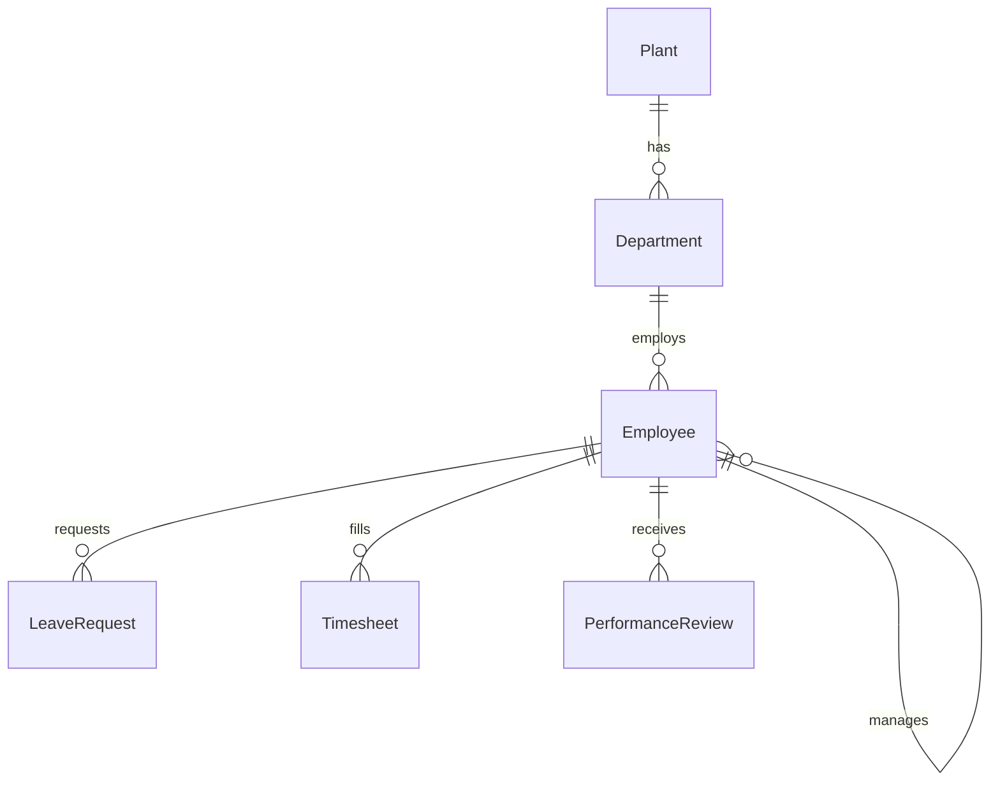

# WorkHub – Employee and HR Management System

This is my capstone project for the Hexaware training program (Python track). WorkHub is an HR
system for a made-up manufacturing company, **Ferrovia Industrial Group**: about 1,200 people across
four plants, who currently manage leave, timesheets and performance reviews with paper forms and
Excel sheets.

This repo is at the end of **Sprint 1**, which was all about the database. The Python application
comes in the next sprints, so the `entity`, `dao`, `exception`, `util`, `main` and `tests` folders
are just placeholders for now.

## What I built in Sprint 1

I designed the database in **SQL Server** (named `WorkHubDB`) and worked with it in SSMS. It has six
tables:

- **Plant** and **Department** – where people work
- **Employee** – including who reports to whom (`ManagerID` points back to the same table)
- **LeaveRequest**, **Timesheet** and **PerformanceReview** – each one belongs to an employee

The ER diagram is in [docs/ER_Diagram.md](docs/ER_Diagram.md). Here's the short version:



I tried to let the database protect itself instead of trusting whoever inserts the data:

- every table has a primary key, and the relationships are real foreign keys
- emails must be unique
- salary can't be negative
- a rating has to be between 1 and 5
- hours worked must be 0–24
- a leave can't end before it starts
- nobody can be their own manager
- new leave requests start as `Pending` automatically

All 25 constraints have proper names (`PK_`, `FK_`, `UQ_`, `CK_`, `DF_`), so when something gets
rejected, the error tells you exactly which rule failed.

For sample data I made 30 employees in a three-level hierarchy, plus leave requests in different
states and reviews for two years. Timesheets have **1,710 rows**: one per employee per working day
from September to mid-November 2026. I generated those with a recursive CTE instead of typing them
by hand.

On top of the tables I added the extra database work from the Stage 1 discussion:

- **views** for the reports (who's on leave today, headcount, salary by department, pending approvals, the full reporting hierarchy)
- **stored procedures** for requesting and approving leave, submitting timesheets and reviews, and assigning managers. Each one fails with a clear error number (50001–50008) when a rule is broken.
- **triggers** for rules that a CHECK constraint can't handle: overlapping approved leave, more than 24 hours in one day, two reviews in the same year, and A-reports-to-B-reports-to-A. They also keep an audit log of leave status changes and salary changes.
- a **cursor job** that goes through every employee and works out their monthly payroll from their timesheets. Every run is logged. SQL Server Express doesn't have SQL Agent, so there's a small `.bat` file for Windows Task Scheduler.
- a small **MongoDB** part for the data that doesn't fit neatly into tables: employee skills and certifications, 360° feedback and notifications. Each collection has schema validation, and there are a few aggregation pipelines for reports.

Near the end of the sprint a new requirement came in: **a waitlist for training courses**. If a
course is full, you join a waitlist, and when someone cancels, the first person in line gets the
seat automatically. I've done the database part (`sql/09_course_waitlist.sql`). The rest of it is
in the backlog for the next sprints.

## How to run it

You'll need SQL Server (Express is fine) with SSMS, and MongoDB with `mongosh` for the MongoDB
part. I used the instance `localhost\SQLEXPRESS`.

The easiest way is the setup script. It rebuilds everything in the right order:

```powershell
powershell -ExecutionPolicy Bypass -File .\setup_databases.ps1
```

If you'd rather do it in SSMS, open the files in the `sql` folder and run them (F5) in this order:
`01`, `02`, `05`, `06`, `07`, `08`, `09`.

One thing I learned the hard way: `01_create_schema.sql` drops and recreates the whole database. If
you don't run `02_sample_data.sql` straight after it, every table is empty.

For MongoDB:

```powershell
mongosh "mongodb://localhost:27017" --file mongodb/01_collections_and_validation.js
mongosh "mongodb://localhost:27017" --file mongodb/02_seed_data.js
```

## Checking that it works

- `sql/03_verify_constraints.sql` tries one good and one bad row for every constraint. It should finish with **25 passed, 0 failed**. Each test is rolled back, so it doesn't change any data.
- `sql/10_stage1_demo.sql` runs through the views, procedures, triggers, the payroll job and the waitlist. Anything that changes data is rolled back too.
- `mongodb/04_validation_tests.js` throws bad documents at MongoDB and checks they're rejected. It should print **15 passed, 0 failed**.
- `sql/04_reporting_queries.sql` has a few handy queries, including the reporting hierarchy.

## Folder layout

```
sql/        all the SQL Server scripts, numbered in the order to run them
mongodb/    the MongoDB scripts
docs/       the ER diagram
jobs/       the scheduled payroll job
setup_databases.ps1   one-click rebuild
entity/ dao/ exception/ util/ main/ tests/   placeholders for Sprints 2–4
```

## Sprint 1 retrospective

What went well: every constraint is tested with both good and bad data, and the error numbers are
the same everywhere. That should make the Python side easier later.

What I'd do differently: the scope grew during the sprint once views, procedures, triggers and
MongoDB were added, and I didn't re-estimate. I also once ran the schema script without the data
script and ended up with an empty database. That's why the setup script exists now.

## What's next

Sprint 2 is object-oriented Python: the entity classes, the Manager/Employee hierarchy and the
business rules. I'll also start on the course waitlist from the app side.
