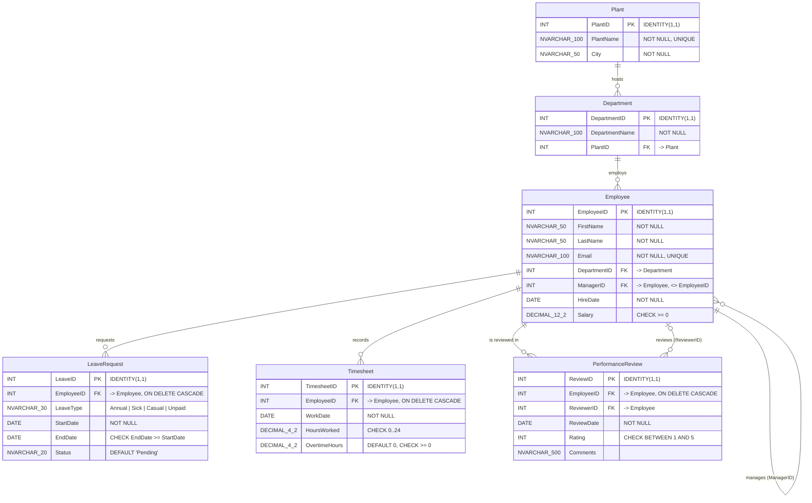

# WorkHubDB – ER Diagram

GitHub renders the diagram below automatically (Mermaid). In SSMS you can also generate it with
**WorkHubDB → Database Diagrams → New Database Diagram → add all six tables**.

## Relationships

| Relationship | Type | Implementation |
|---|---|---|
| LeaveRequest – Employee | Many-to-One | `LeaveRequest.EmployeeID` → `Employee.EmployeeID` |
| Timesheet – Employee | Many-to-One | `Timesheet.EmployeeID` → `Employee.EmployeeID` |
| PerformanceReview – Employee | Many-to-One | `PerformanceReview.EmployeeID` → `Employee.EmployeeID` |
| Employee – Department | Many-to-One | `Employee.DepartmentID` → `Department.DepartmentID` |
| Department – Plant | Many-to-One | `Department.PlantID` → `Plant.PlantID` |
| Employee – Manager | Many-to-One (self) | `Employee.ManagerID` → `Employee.EmployeeID` (reporting hierarchy) |
| PerformanceReview – Reviewer | Many-to-One | `PerformanceReview.ReviewerID` → `Employee.EmployeeID` |

The three relationships required by the case study are the first three rows. The other
foreign keys enforce the "Identifier of the related …" columns so the data stays consistent.

`ReviewerID` uses `NO ACTION` because SQL Server does not allow a second cascade path to
`Employee`; `EmployeeService.delete_employee()` clears it inside the same transaction instead.
